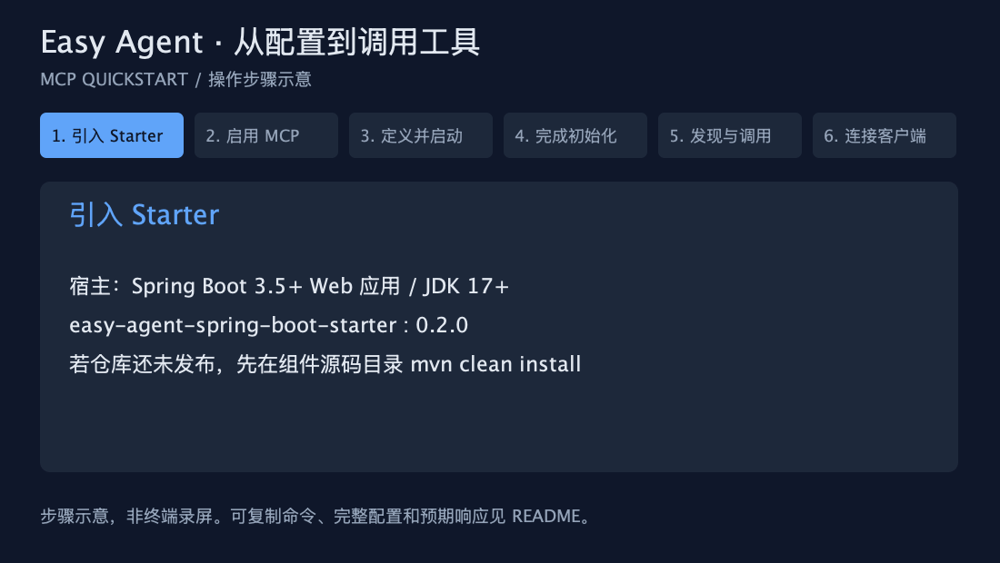
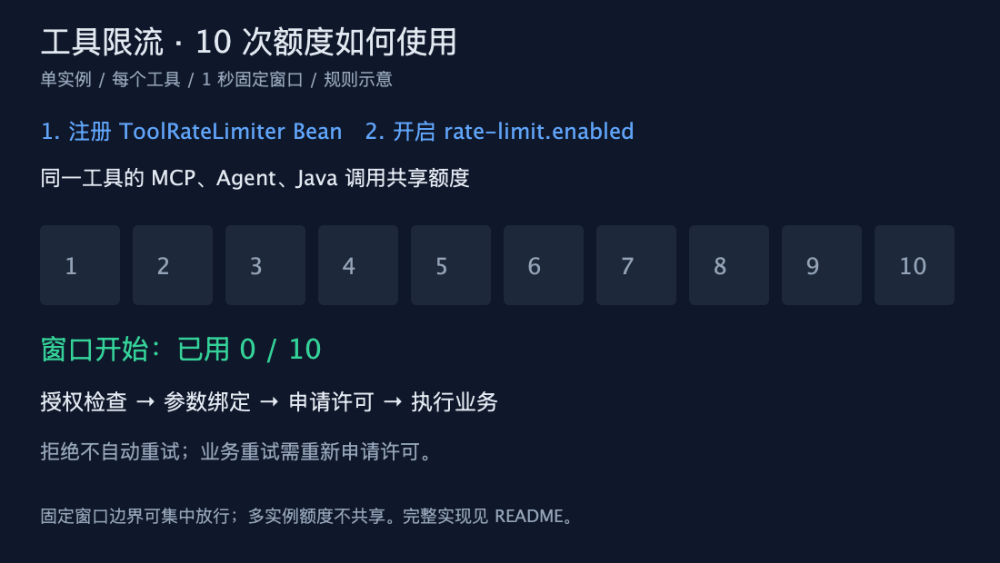

# Easy Agent

<p align="center">
  <strong> Java 应用打造的 Agent 开发组件</strong>
</p>

<p align="center">
  
  
  
  
</p>

---

## 项目简介

Easy Agent 是一个面向 Java 应用的智能体（Agent）开发组件，深度拥抱 Spring 生态，旨在让基于 Spring Boot 的应用快速暴露业务工具、接入大模型、提供 MCP 工具服务，并使用本地文档做基础 RAG 检索。开发者引入 Starter 后，可以通过配置开关启用注解式工具注册、MCP HTTP 接口、Skill 文件生成、RAG 检索和 OpenAI 兼容 LLM 客户端。

### 核心理念

- **零侵入**：通过 `@EasyTool` 注解自动发现和注册工具，无需修改业务代码结构
- **即插即用**：引入 Starter 依赖即可自动装配，通过配置开关控制各模块
- **灵活组合**：未配置 LLM 时也可以仅提供 MCP 工具调用能力
- **领域友好**：Skill 生成器通过对话式引导，生成你的专属业务 Skill Markdown 文件

需要限制工具调用频率时，请按[工具限流接入](#工具限流接入)完成配置、注册限流器 Bean，并验证拒绝结果。

### 阅读导航

- [快速开始](#快速开始)：不配置模型或知识库，先验证工具发现与调用
- [MCP 协议与 Claude Code 接入](#4-mcp-协议支持)
- [多模型适配](#5-多模型适配llm) / [完整配置参考](#完整配置参考)
- [工具限流接入](#工具限流接入)：实现、配置和验证
- [常见问题](#常见问题) / [0.2.0 迁移说明](#020-工具执行契约与迁移)

### MCP 治理说明

- 默认情况下，MCP 会暴露所有已启用工具，保持现有行为不变
- 如果你希望收敛暴露范围，可以开启 `easy-agent.mcp.tool-exposure.enabled`
- 支持按工具名、来源、分类做允许/屏蔽控制
- 所有 MCP 错误现在统一使用错误枚举和错误工厂生成，便于客户端稳定识别

其中：
- `allowed-tools` / `blocked-tools` 填工具名，例如 `queryUserPermission`、`createOrder`
- `allowed-sources` / `blocked-sources` 填工具来源，例如 `annotation`、`skill`、`BusinessToolProvider`
- `allowed-categories` / `blocked-categories` 填工具分类，例如 `user`、`order`、`report`
- `category` 是你在 `@EasyTool(category = "...")` 中自定义的业务分组名
- `source` 是工具来源标签，注解工具默认是 `annotation`，SPI 工具默认是提供者类名

示例：
- 只暴露用户相关工具：`allowed-categories: [user]`
- 屏蔽报表类工具：`blocked-categories: [report]`
- 只允许注解式工具：`allowed-sources: [annotation]`
- 只允许 Skill 元工具：`allowed-sources: [skill]`
- 屏蔽某个具体工具：`blocked-tools: [deleteUser, exportReport]`

---

## 技术栈

| 类别 | 技术 | 版本 |
|------|------|------|
| 基础框架 | Spring Boot | 3.5+ |
| AI 框架 | Spring AI | 1.0+ |
| JDK | OpenJDK / Oracle JDK | 17+ |
| 向量存储 | 内存存储（当前默认）/ PGVector 占位实现 | - |
| PDF 解析 | Apache PDFBox | 3.0.5 |
| JSON | Jackson | Spring Boot 内置 |
| 构建工具 | Maven | 3.9+ |


### 支持的大模型

| Provider | 说明 | 接入方式 |
|----------|------|----------|
| **DashScope（通义千问）** | 阿里云通义千问系列模型 | OpenAI 兼容 API |
| **DeepSeek** | DeepSeek 系列模型 | OpenAI 兼容 API |
| **Ollama** | 本地私有化部署模型 | OpenAI 兼容 API |
| **OpenAI** | GPT 系列模型 | OpenAI API |

---

## 模块架构

```
easy-agent
├── easy-agent-core                    # 核心模块：注解、注册中心、执行器
├── easy-agent-rag                     # RAG 模块：PDF/Excel 加载、内存检索、多搜索策略
├── easy-agent-mcp                     # MCP 模块：HTTP JSON-RPC 工具服务
├── easy-agent-skill                   # Skill 模块：业务 Skill Markdown 文件生成服务
├── easy-agent-llm                     # LLM 模块：多模型适配、OpenAI 兼容客户端
├── easy-agent-spring-boot-starter     # Starter：自动装配、配置元数据
```

---

## 功能详解

### 1. @EasyTool 注解式工具注册

在任意 Spring Bean 的方法上添加 `@EasyTool` 注解，该方法便会自动注册到 `ToolRegistry`，可以通过 `ToolExecutor` 执行，也可以通过 MCP 的 `tools/list` 和 `tools/call` 暴露给客户端调用。

```java
@Service
public class OrderService {

    @EasyTool(name = "queryOrder", description = "根据订单号查询订单详情")
    public OrderResult queryOrder(
            @ToolParam(name = "orderId", description = "订单号") String orderId) {
        return orderRepository.findById(orderId);
    }

    @EasyTool(name = "cancelOrder", description = "取消指定订单", category = "order")
    public CancelResult cancelOrder(
            @ToolParam(name = "orderId", description = "订单号") String orderId,
            @ToolParam(name = "reason", description = "取消原因", required = false) String reason) {
        return orderService.cancel(orderId, reason);
    }
}
```

**核心组件：**

| 组件 | 说明 |
|------|------|
| `@EasyTool` | 方法级注解，声明工具名称、描述、分类、启用状态 |
| `@ToolParam` | 参数级注解，声明参数名称、描述、是否必填 |
| `ToolRegistry` | 工具注册中心，管理所有已注册的工具定义 |
| `ToolExecutor` | 工具执行器，负责参数解析、反射调用、结果序列化 |
| `EasyToolBeanPostProcessor` | Bean 后置处理器，自动扫描并注册 @EasyTool 方法 |

工具执行入口会检查 `enabled` 并在业务方法执行前校验参数。参数必须是单个 JSON 对象（无参数工具使用 `{}`）；缺少必填参数、类型转换失败及小数转整数等情况返回失败，不会使用 `0` / `false` 等默认值继续执行。可选参数建议使用 `Integer`、`Boolean` 等包装类型，基本类型参数不能缺失或为 `null`。

**SPI 接口：**

- `ToolProvider`：自定义工具提供者，可编程式注册工具
- `ToolExecutionListener`：工具执行监听器，支持 before/after/error 钩子

业务系统引入 Starter 后，只需要把 `ToolProvider` 声明为 Spring Bean，easy-agent 会自动收集并注册其返回的工具定义。`priority()` 数值越小越先注册；自动注册遇到重复工具名会启动失败，不会按优先级覆盖。示例中的 `permissionService` 必须是宿主中已有的 Bean，且公开 `queryCurrentUserPermission()` 方法；重载方法需要显式绑定，见[迁移说明](#类型schema-与-spi-兼容)。

```java
@Component
public class BusinessToolProvider implements ToolProvider {

    @Override
    public Collection<ToolDefinition> provide() {
        return List.of(new ToolDefinition(
                "queryUserPermission",
                "查询当前用户权限",
                "user",
                "permissionService",
                "queryCurrentUserPermission",
                List.of(),
                true
        ));
    }

    @Override
    public int priority() {
        return 0;
    }
}
```

业务系统也可以声明 `ToolExecutionListener` Bean，用于记录日志、审计、监控埋点或统计工具调用情况。`beforeExecution` 在业务工具调用前触发，`afterExecution` 在调用成功后触发，`onError` 在调用失败时触发。

```java
@Slf4j
@Component
public class BusinessToolExecutionListener implements ToolExecutionListener {

    @Override
    public void beforeExecution(ToolInvocation invocation) {
        log.info("准备执行工具：{}", invocation.toolName());
    }

    @Override
    public void afterExecution(ToolInvocation invocation, ToolResult result) {
        log.info("工具执行成功：{}", invocation.toolName());
    }

    @Override
    public void onError(ToolInvocation invocation, Throwable error) {
        log.warn("工具执行失败：{}", invocation.toolName(), error);
    }
}
```

该监听器示例使用 Lombok 的 `@Slf4j`，需要导入 `lombok.extern.slf4j.Slf4j`。监听事件按一次逻辑调用触发：`beforeExecution` 一次，最终 `afterExecution` 或 `onError` 一次；授权、参数或限流拒绝发生在业务前置事件之前。

---

### 2. Skill 文件生成

Skill 模块当前提供的是业务 Skill Markdown 文件生成能力：通过 Core SPI 注册 `skill.list_tools` 和 `skill.generate` 两个元工具，再由 MCP 统一暴露给 Claude Code 等客户端。用户可以查看当前项目中的 `@EasyTool` 工具，并生成业务侧自己的 Skill 描述文件。

**核心组件：**

| 组件 | 说明 |
|------|------|
| `SkillGeneratorService` | 读取已注册工具，生成业务 Skill Markdown 文件 |
| `SkillToolService` | 提供 `skill.list_tools` 和 `skill.generate` 的具体执行逻辑 |
| `SkillToolProvider` | 将 Skill 元工具注册到 Core `ToolRegistry` |
| `create-skill.md` | 内置元技能说明文档，引导客户端如何生成 Skill |

生成文件默认写入项目根目录下的 `skill/{name}.md`，可通过 `easy-agent.skill.skill-output-path` 调整根目录。同名文件已存在时，工具会返回冲突提示，由客户端引导使用者选择生成副本或覆盖后再次调用。

> MCP 模块不直接依赖 Skill 模块。Skill 元工具会像普通工具一样进入 `ToolRegistry`，MCP 只负责暴露已注册工具。

> 当前版本不包含 Skill 文件解析、运行时加载、注册中心或文件热更新能力。

---

### 3. RAG 检索增强生成

RAG 模块支持在启动时加载 `classpath:knowledge/` 下的 PDF、Excel 文件，也支持运行时添加 PDF、Excel、HTML 文件和在线 HTML 知识库 URL，内容会切分为 `DocumentChunk` 后放入检索存储，并提供 Embedding、Cosine、TF-IDF 三种搜索策略。检索结果会在 `DocumentChunk.score` 中携带相关性分数。

**存储策略：**

| 模式 | 当前行为 |
|------|----------|
| `AUTO` | 使用内存存储 |
| `IN_MEMORY` | 使用内存存储 |
| `PGVECTOR` | 会创建 PgVector 占位 Provider，但当前 add/search/delete 仍不可用 |

> 当前推荐使用 `AUTO` 或 `IN_MEMORY`。PgVector 配置和占位类已存在，但还不是完整可用的持久化向量库实现。

**搜索策略：**

- `AUTO` 会按 Embedding、Cosine、TF-IDF 顺序降级检索
- Embedding 检索会在文档加入内存存储时生成文档向量，查询时只生成 query 向量
- Cosine 和 TF-IDF 不依赖外部服务，适合作为本地兜底策略
- 内置检索策略对空白查询及 `topK=0` 返回空列表，负数 `topK` 抛出 `IllegalArgumentException`
- TF-IDF 使用平滑 IDF，单篇文档和所有文档共有的词也能获得正分数；升级后分数会变化，已有自定义 `min-score` 需重新评估

**文档加载：**

- 自动扫描 `classpath:knowledge/` 下的 PDF 文件、Excel 文件
- PDF 支持按字符长度分块（可配置 chunk 大小和重叠）
- PDF 的 `chunk-overlap` 必须小于 `chunk-size`
- Excel 按行生成文档块
- HTML 文件和 URL 页面会清理脚本、样式、导航、页脚等噪音后提取正文
- 启动时自动索引，无需手动操作

**运行时维护：**

- 支持运行时添加 PDF、Excel、HTML 文档到知识库
- 支持运行时添加在线 HTML 知识库 URL 到知识库
- 支持按 `source` 删除文档块
- 支持按 `documentId` 删除文档块
- 同一 `documentId` 的运行时文档或 URL 页面解析成功后替换旧内容；新内容为空时删除旧块，解析失败时保留旧块
- 自动扫描 PDF/Excel 时按资源 URI 生成文档 ID，避免不同目录同名文件互相覆盖；删除这些文档请使用返回块元数据中的 `documentId`
- 支持清空索引
- 支持重新扫描默认知识库目录并重建索引

> easy-agent 只提供 Java API，不默认暴露上传接口。业务系统负责上传入口、权限控制、文件大小限制、用户或租户隔离。
> URL 知识库默认只允许 `http` / `https`，并内置拦截 `localhost`、`127.0.0.1`、`0.0.0.0`、内网 IP、link-local 等 SSRF 风险地址；如配置 `allowed-domains`，则只允许访问命中的域名或 IP 通配范围。

```java
@Service
public class KnowledgeService {

    private final RagService ragService;

    private final LlmService llmService;

    public KnowledgeService(RagService ragService, LlmService llmService) {
        this.ragService = ragService;
        this.llmService = llmService;
    }

    public ChatResponse answerQuestion(String question) {
        String context = ragService.searchAndConcat(question, 5);
        // 将检索结果作为上下文传给 LLM
        return llmService.chat(List.of(
            ChatMessage.system("基于以下知识回答问题:\n" + context),
            ChatMessage.user(question)
        ));
    }
}
```

---

### 4. MCP 协议支持

实现了轻量 MCP（Model Context Protocol）HTTP 服务端，未配置 LLM 时也可仅提供 MCP 能力，让 Claude Code 等 MCP 客户端直接调用 `@EasyTool` 注册的工具。

当前 MCP 模块是无会话的基础工具型 HTTP 服务端，返回 JSON，不提供 SSE 推送，也不创建 `MCP-Session-Id`。默认协议版本为 `2025-11-25`，可协商 `2025-06-18`、`2025-03-26` 和原有的 `2024-11-05` 消息版本；不提供旧版 HTTP+SSE 传输。

`initialize` 必须提供 `protocolVersion`、`capabilities` 和包含 `name`、`version` 的 `clientInfo`。支持的版本原样返回，不支持的非空版本协商为 `2025-11-25`，由客户端决定是否继续；缺少字段或字段类型错误返回 `INVALID_PARAMS`。初始化成功后，客户端发送 `notifications/initialized`，再列出或调用工具。服务端不保存客户端初始化状态，客户端负责遵守调用顺序。

MCP 的工具暴露支持可选治理：默认仍然暴露所有已启用工具；如果开启 `easy-agent.mcp.tool-exposure.enabled`，则可以按工具名、来源、分类做允许或屏蔽控制。MCP 错误也已统一收口到错误枚举与错误工厂，便于客户端稳定识别错误类型。

**协议实现：**

| 方法 | 说明 |
|------|------|
| `initialize` | 初始化握手，返回服务端能力和版本信息 |
| `tools/list` | 列出启用且符合 MCP 暴露规则的工具，不按用户执行权限裁剪 |
| `tools/call` | 调用指定工具 |
| `resources/list` | 资源列表（预留） |
| `prompts/list` | 提示词列表（预留） |
| `ping` | 心跳检测 |

**传输方式：**

- **HTTP POST `/mcp`**：单条 JSON-RPC 2.0 消息，`Content-Type: application/json`，`Accept: application/json, text/event-stream`。请求必须包含字符串或整数 `id`，正常返回 HTTP 200 和 JSON 结果或 JSON-RPC 错误。
- **通知**：`notifications/*` 消息必须省略 `id`，合法通知返回 HTTP 202，响应体为空。未知通知安全忽略；通知不执行工具。
- **错误输入**：非法 JSON 返回 HTTP 400 / `PARSE_ERROR`；非法消息结构返回 HTTP 400 / `INVALID_REQUEST`；缺少可接受的响应类型返回 HTTP 406。批量数组、客户端响应及无 `id` 的工具调用不会执行工具。
- **协议版本头**：初始化之后发送协商后的 `MCP-Protocol-Version`；不支持的版本头返回 HTTP 400。省略时按 `2025-03-26` 兼容基线处理。
- **HTTP GET / DELETE `/mcp`**：返回 HTTP 405；原 GET URL 参数调试调用已移除，请改用 POST。
- **Origin 校验**：即使关闭 CORS，携带 Origin 的请求仍须匹配 `easy-agent.mcp.cors.allowed-origin-patterns`；默认允许 localhost 和 127.0.0.1 的 HTTP 来源，不允许的来源返回 HTTP 403。未携带 Origin 的原生客户端可以访问。该校验不代替业务系统的身份认证。

最小初始化请求：

```bash
curl -i http://localhost:8080/mcp \
  -H 'Content-Type: application/json' \
  -H 'Accept: application/json, text/event-stream' \
  -d '{"jsonrpc":"2.0","id":1,"method":"initialize","params":{"protocolVersion":"2025-11-25","capabilities":{},"clientInfo":{"name":"demo","version":"1.0"}}}'
```

原有仅发送 `protocolVersion` 的初始化请求需要补充字段；原有 curl POST 调试命令需要补充上述 Accept 头。


**MCP 客户端配置示例（Claude Code）：**

```json
{
  "mcpServers": {
    "easy-agent": {
      "type": "http",
      "url": "http://localhost:8080/mcp"
    }
  }
}
```

**连接命令（Claude Code）：**

```bash
claude mcp add --transport http easy-agent http://localhost:8080/mcp
claude mcp list
```

在运行 Claude Code 的终端执行上述命令，然后启动 `claude`，输入 `/mcp` 检查连接状态。URL 必须从 Claude Code 所在机器可访问；部署在其他主机或容器时调整地址和端口。JSON 示例可用于项目的 `.mcp.json`；命令和字段说明见 [Claude Code 官方 MCP 文档](https://code.claude.com/docs/en/mcp)。

---

### 5. 多模型适配（LLM）

基于 OpenAI 兼容 API 的统一 HTTP 客户端，一套代码适配多家大模型供应商。当前支持普通对话、简单流式对话、Tool Calls 解析，以及基于已注册 `@EasyTool` 的自动工具调用闭环。

| 组件 | 说明 |
|------|------|
| `LlmService` | 底层大模型对话服务，支持普通对话、流式对话和手动传入工具定义 |
| `AgentLlmService` | Agent 编排服务，自动读取 `ToolRegistry` 中的工具、调用模型、执行工具并继续对话 |

**简化配置（推荐）：**

先在启动宿主应用的终端设置 API Key（例如 `export LLM_API_KEY='你的实际密钥'`），IDE 启动时在运行配置中设置同名环境变量。下面示例通过 `${LLM_API_KEY}` 读取；Ollama 本地服务可按其独立示例配置。

```yaml
easy-agent:
  llm:
    enabled: true
    model: qwen-plus              # 通过模型名自动识别 provider
    api-key: ${LLM_API_KEY}          # 通用 API Key（优先使用）
    tool-execution:
      max-tool-rounds: 5              # 最多允许模型连续发起多少轮工具调用
      fallback-to-chat-enabled: true  # 模型工具调用请求失败后是否降级为普通对话
      repeated-tool-call-threshold: 3 # 同一工具名和原始参数组合在本次会话中累计出现的停止阈值
    request-retry:
      max-attempts: 1                 # 模型请求的总尝试次数，不重放业务工具
      backoff-millis: 0
```

> **注意**：`provider` 可省略，系统会根据 `model` 名称自动推断：
> - 包含 `qwen` 或 `tongyi` → dashscope（通义千问）
> - 包含 `deepseek` → deepseek
> - 包含 `llama`、`mistral` → ollama
> - 包含 `gpt`、`o1`、`o3` → openai
> - 其他 → 默认使用 dashscope

> **提示**：顶层的 `api-key` 和 `model` 会优先使用。如果需要自定义 baseUrl，请在对应的 provider 内部配置。

> **提示**：`tool-execution` 控制 Agent 轮次、模型请求失败时的降级和循环保护；业务工具重试统一配置在 `easy-agent.execution`，模型请求重试配置在 `request-retry`。

| 配置项 | 作用 | 默认值 | 是否必须 |
|------|------|------|------|
| `max-tool-rounds` | 最多执行的工具调用轮数；达到上限后额外请求一次无工具的最终回答 | `5` | 否 |
| `fallback-to-chat-enabled` | 模型工具调用请求失败后是否降级为普通对话 | `true` | 否 |
| `repeated-tool-call-threshold` | 同一工具名和原始参数组合累计出现多少次时停止执行，阈值这一次也会被跳过 | `3` | 否 |

达到工具调用轮次上限后，服务会保留完整对话及已执行工具的结果，再调用普通聊天接口生成最终回答，因此可能额外产生一次模型请求。重复调用保护触发时，会为被跳过的调用回填停止原因，再生成最终回答。最终回答请求失败时返回明确的失败信息，不返回未完成的工具调用。直接传入 `chatWithRegisteredTools(messages, maxToolRounds)` 的轮次必须大于 0。

**供应商配置示例（四选一，不要将多个 `easy-agent` 根节点复制到同一个 YAML 文档）：**

```yaml
# 通义千问
easy-agent:
  llm:
    provider: dashscope
    dash-scope:
      api-key: ${LLM_API_KEY}
      model: qwen-max
```

```yaml
# DeepSeek
easy-agent:
  llm:
    provider: deepseek
    deep-seek:
      api-key: ${LLM_API_KEY}
      model: deepseek-chat
```

```yaml
# Ollama（本地部署）
easy-agent:
  llm:
    provider: ollama
    ollama:
      base-url: http://localhost:11434
      model: llama3
```

```yaml
# OpenAI
easy-agent:
  llm:
    provider: openai
    open-ai:
      api-key: ${LLM_API_KEY}
      model: gpt-4o
```

## 快速开始

前提：JDK 17+、Maven 3.9+，以及包含 `spring-boot-starter-web` 的 Spring Boot 3.5+ Servlet Web 应用。下面先使用本地 MCP 验证工具，不需要模型 API Key、数据库或知识库。



*动图为步骤示意，非真实终端录屏；可复制命令与预期结果见下文。*

### 1. 引入依赖

将以下依赖添加到宿主应用的 `pom.xml`。本文对应当前源码版本 `0.2.0`；若所用 Maven 仓库尚未提供该版本，先在本仓库根目录使用 JDK 17 执行 `mvn clean install`，再构建宿主应用。

```xml
<dependency>
    <groupId>io.github.songrongzhen</groupId>
    <artifactId>easy-agent-spring-boot-starter</artifactId>
    <version>0.2.0</version>
</dependency>
```

### 2. 添加最小配置

写入宿主应用的 `src/main/resources/application.yml`：

```yaml
server:
  port: 8080

easy-agent:
  mcp:
    enabled: true
  llm:
    enabled: false
  rag:
    enabled: false
  skill:
    enabled: false
```

此配置只启用工具注册与 MCP。后续按需开启 LLM、RAG、Skill 或[工具限流](#工具限流接入)；各配置合并到同一个 `easy-agent` 根节点下。

### 3. 定义工具并启动

假设宿主启动类位于 `com.example.demo`，新增 `src/main/java/com/example/demo/MyTools.java`。如果使用其他包名，请相应调整，并保证工具类在 `@SpringBootApplication` 的扫描范围内。工具使用普通非懒加载的单例 Bean。

```java
package com.example.demo;

import io.github.songrongzhen.easyagent.core.annotation.EasyTool;
import io.github.songrongzhen.easyagent.core.annotation.ToolParam;
import org.springframework.stereotype.Component;

/**
 * 快速开始示例工具。
 */
@Component
public class MyTools {

    /**
     * 根据调用方传入的名称返回问候语。
     */
    @EasyTool(name = "hello", description = "向指定用户打招呼")
    public String hello(@ToolParam(name = "name", description = "用户名称") String name) {
        return "你好，" + name + "！";
    }
}
```

从宿主应用的 IDE 启动其 `@SpringBootApplication` 主类，保持服务运行。若宿主已配置 `spring-boot-maven-plugin`，也可以在宿主目录执行 `mvn spring-boot:run`。本仓库是组件库，在本仓库根目录运行该命令不会启动上述宿主应用。

### 4. 初始化、列出并调用工具

在另一个终端依次执行下列命令（Bash、Zsh 等 Shell）：

```bash
# 初始化：预期 HTTP 200，result 中包含协商版本和服务信息。
curl -i http://localhost:8080/mcp \
  -H 'Content-Type: application/json' \
  -H 'Accept: application/json, text/event-stream' \
  -d '{"jsonrpc":"2.0","id":1,"method":"initialize","params":{"protocolVersion":"2025-11-25","capabilities":{},"clientInfo":{"name":"readme-demo","version":"1.0"}}}'

# 初始化完成通知：预期 HTTP 202，无响应体。
curl -i http://localhost:8080/mcp \
  -H 'Content-Type: application/json' \
  -H 'Accept: application/json, text/event-stream' \
  -H 'MCP-Protocol-Version: 2025-11-25' \
  -d '{"jsonrpc":"2.0","method":"notifications/initialized"}'

# 发现工具：预期 result.tools 中包含 hello，以及 name 参数的 Schema。
curl -sS http://localhost:8080/mcp \
  -H 'Content-Type: application/json' \
  -H 'Accept: application/json, text/event-stream' \
  -H 'MCP-Protocol-Version: 2025-11-25' \
  -d '{"jsonrpc":"2.0","id":2,"method":"tools/list","params":{}}'

# 调用工具：预期 isError=false，文本内容为“你好，张三！”。
curl -sS http://localhost:8080/mcp \
  -H 'Content-Type: application/json' \
  -H 'Accept: application/json, text/event-stream' \
  -H 'MCP-Protocol-Version: 2025-11-25' \
  -d '{"jsonrpc":"2.0","id":3,"method":"tools/call","params":{"name":"hello","arguments":{"name":"张三"}}}'
```

最后一步的结果应包含：

```json
{"jsonrpc":"2.0","id":3,"result":{"content":[{"type":"text","text":"你好，张三！"}],"isError":false}}
```

无参数工具也需要传 `"arguments": {}`。服务端返回 `isError=true` 时，应查看工具错误内容；仅 HTTP 200 不代表业务执行成功。连接失败或返回 400/406 时，见[常见问题](#常见问题)。

### 5. 连接 Claude Code（可选）

先确保上一步工具调用成功，再执行：

```bash
claude mcp add --transport http easy-agent http://localhost:8080/mcp
claude mcp list
claude
```

在 Claude Code 内输入 `/mcp` 检查连接，然后输入“使用 hello 工具向张三打招呼”。按照客户端提示允许调用后，应得到问候结果。MCP 客户端所使用的模型由客户端配置，宿主应用的 `easy-agent.llm` 可以保持关闭。

### 6. 开启其他模块（可选）

| 目标 | 接入步骤 |
|------|----------|
| 在 Java 内使用 Agent 调用模型与工具 | 按[多模型适配](#5-多模型适配llm)开启 `llm.enabled` 并配置 API Key，注入 `AgentLlmService` |
| 使用知识库检索 | 开启 `rag.enabled`，把 PDF、Excel 放入 `src/main/resources/knowledge/`；使用本地检索时可关闭 `search.embedding.enabled` |
| 生成业务 Skill 文件 | 开启 `skill.enabled`，连接 MCP 后调用 `skill.list_tools` 和 `skill.generate`，也可让客户端引导生成 |
| 限制工具调用频率 | 按[工具限流接入](#工具限流接入)注册限流器 Bean 并开启配置 |

## 完整配置参考

以下是可选模块的配置参考，首次接入建议先使用上面的最小配置。启用 LLM 前先设置 `LLM_API_KEY` 环境变量；启用 Embedding 检索时需由宿主提供 `EmbeddingModel` Bean。`authorization.required` 和 `rate-limit.enabled` 开启前必须分别提供对应策略 Bean。

```yaml
server:
  port: 8080
easy-agent:
  # 各入口共用的工具执行配置
  execution:
    authorization:
      required: false
    rate-limit:
      enabled: false
    metrics:
      enabled: false
    retry:
      default-max-attempts: 1
      default-backoff-millis: 0
    # 多次尝试须声明安全属性；按实际工具名称配置
    tools:
      queryUser:
        effect: READ_ONLY
        max-attempts: 3
        backoff-millis: 200
  # MCP 配置
  mcp:
    # 是否启用 MCP HTTP 工具服务
    enabled: true
    # MCP 初始化握手时返回的服务名称
    server-name: easy-agent-mcp-server
    # MCP 初始化握手时返回的服务版本
    server-version: 0.2.0
    # 是否开启 MCP 工具暴露过滤，默认 false；不配置时保持全部暴露
    tool-exposure:
      # 是否启用过滤层
      enabled: false
      # 允许暴露的工具名列表；配置后仅这些工具可见
      allowed-tools:
        # - queryUserPermission
        # - createOrder
      # 屏蔽的工具名列表；优先级高于允许列表
      blocked-tools:
        # - deleteUser
        # - exportReport
      # 允许暴露的工具来源列表，例如 annotation / skill / BusinessToolProvider
      allowed-sources:
        # - annotation
        # - skill
        # - BusinessToolProvider
      # 屏蔽的工具来源列表
      blocked-sources:
        # - annotation
      # 允许暴露的工具分类列表
      allowed-categories:
        # - user
        # - order
      # 屏蔽的工具分类列表
      blocked-categories:
        # - report
    # MCP 接口跨域配置，仅作用于 /mcp/** 路径 （CORS 配置可以不写，默认开启本地跨域。）
    cors:
      # 是否启用 MCP CORS 过滤器
      enabled: true
      # 允许访问 MCP 接口的来源，支持 Spring 的 origin pattern
      allowed-origin-patterns:
        - http://localhost:*
        - http://127.0.0.1:*
      # 允许的请求头
      allowed-headers:
        - "*"
      # 允许的 HTTP 方法
      allowed-methods:
        - GET
        - POST
        - OPTIONS
      # 允许浏览器读取的响应头
      exposed-headers:
        - Content-Type
  llm:
    enabled: true
    model: "qwen-plus"
    api-key: ${LLM_API_KEY}  # 启动前设置环境变量 LLM_API_KEY
    request-retry:
      max-attempts: 1
      backoff-millis: 0
    tool-execution:
      max-tool-rounds: 5
      fallback-to-chat-enabled: true
      repeated-tool-call-threshold: 3

  # RAG 配置（可选）
  rag:
    # 是否启用 RAG 功能
    enabled: true
    # 向量存储类型：AUTO、IN_MEMORY、PGVECTOR
    # AUTO 和 IN_MEMORY 使用内存存储；PGVECTOR 当前为占位 Provider，暂不可用于实际检索
    storage-type: IN_MEMORY
    search:
      # 搜索策略：AUTO（Embedding -> Cosine -> TF-IDF 降级）、EMBEDDING、COSINE、TF_IDF
      strategy: AUTO
      embedding:
        # 是否启用 Embedding 向量检索（最精准，但需要配置 Embedding 服务）
        enabled: true
        # Embedding 服务提供者配置项已预留；实际 EmbeddingModel 由 Spring 容器提供
        provider: DASHSCOPE
        # Embedding 模型名称
        model: nomic-embed-text
      cosine:
        # 是否启用余弦相似度搜索（作为 Embedding 的降级方案）
        enabled: true
      tfIdf:
        # 是否启用 TF-IDF 搜索（兜底方案，不需要外部服务）
        enabled: true
    pdf:
      # 是否启用 PDF 文档加载
      enabled: true
      # PDF 文件所在目录（支持 classpath: 前缀）
      resource-path: classpath:knowledge/
      # PDF 文档块字符长度
      chunk-size: 1000
      # PDF 文档块重叠字符数，必须小于 chunk-size
      chunk-overlap: 200
    excel:
      # 是否启用 Excel 文档加载
      enabled: true
      # Excel 文件所在目录（支持 classpath: 前缀）
      resource-path: classpath:knowledge/
    html:
      # 请求用户指定 HTML 知识库 URL 的超时时间，非必须，默认 30s
      html-request-timeout: 30s
      # 允许请求的域名或 IP 范围，非必须；支持 * 通配符
      # 不配置时允许正常公网 http/https URL，但仍会默认拦截 localhost、内网 IP 等 SSRF 风险地址
      allowed-domains:
        # - docs.company.com
        # - "*.company.com"
        # - 189.30.56.*
    # 说明：pdf.enabled 和 excel.enabled 同时影响启动加载和运行时 addDocument 支持的文件类型；html 配置用于 addUrl 请求控制
  # Skill 配置（可选；不配置时默认启用，并在项目根目录下生成 /skill/）
  skill:
    # 是否启用业务 Skill Markdown 文件生成能力，默认 true
    enabled: true
    # 生成目录的根路径，默认 .；最终文件写入 ${skill-output-path}/skill/
    skill-output-path: .
# 日志配置
logging:
  level:
    io.github.songrongzhen: DEBUG
```

---

## 项目结构

以下列出主要文件，省略测试及部分辅助类。

```
easy-agent/
├── pom.xml                                    # 父 POM：依赖管理、插件配置
├── easy-agent-core/
│   └── src/main/java/.../core/
│       ├── annotation/
│       │   ├── EasyTool.java                  # 核心注解：标记方法为 LLM 工具
│       │   └── ToolParam.java                 # 参数注解：描述工具参数
│       ├── model/
│       │   ├── RegisteredTool.java            # 确定方法、代理与完整输入 Schema
│       │   ├── ToolCallContext.java           # 可信身份与调用上下文
│       │   ├── ToolError.java                 # 结构化错误
│       │   ├── ToolDefinition.java            # 工具定义（名称、描述、参数等）
│       │   ├── ParameterDefinition.java       # 参数定义
│       │   ├── ToolInvocation.java            # 工具调用请求
│       │   └── ToolResult.java                # 工具调用结果
│       ├── registry/
│       │   ├── ToolMethodResolver.java        # 方法与完整泛型解析
│       │   └── ToolRegistry.java              # 工具注册中心
│       ├── schema/
│       │   └── ToolSchemaGenerator.java       # MCP / Agent 共用 Schema
│       ├── config/
│       │   └── ToolExecutionOptions.java      # 工具副作用类别与执行选项
│       ├── executor/
│       │   └── ToolExecutor.java              # 授权、绑定、限流、代理调用与重试
│       ├── processor/
│       │   ├── ToolProviderRegistrar.java     # SPI 工具注册
│       │   └── EasyToolBeanPostProcessor.java # Bean 后置处理器（自动注册）
│       ├── spi/
│       │   ├── ToolAuthorizationPolicy.java   # SPI：执行授权
│       │   ├── ToolRateLimiter.java           # SPI：非阻塞许可申请
│       │   ├── ToolExceptionMapper.java       # SPI：业务异常分类
│       │   ├── ToolRetryPolicy.java           # SPI：安全重试判断
│       │   ├── ToolObservation.java           # SPI：逻辑调用与尝试观测
│       │   ├── ToolProvider.java              # SPI：自定义工具提供者
│       │   └── ToolExecutionListener.java     # SPI：工具执行监听器
│       └── exception/
│           ├── EasyAgentException.java        # 基础异常
│           ├── ToolExecutionException.java    # 工具执行异常
│           └── ToolNotFoundException.java     # 工具未找到异常
├── easy-agent-rag/
│   └── src/main/java/.../rag/
│       ├── config/
│       │   └── EasyAgentRagProperties.java    # RAG 配置属性
│       ├── store/
│       │   ├── VectorStoreProvider.java       # 向量存储接口
│       │   ├── PgVectorStoreProvider.java     # PGVector 占位实现
│       │   ├── InMemoryVectorStoreProvider.java # 内存实现
│       │   ├── VectorStoreProviderFactory.java # 存储工厂
│       │   └── DocumentChunk.java             # 文档分块模型
│       ├── loader/
│       │   ├── DocumentLoader.java            # 文档加载接口
│       │   ├── PdfDocumentLoader.java         # PDF 文档加载与分块
│       │   └── ExcelDocumentLoader.java       # Excel 文档加载与分块
│       ├── search/
│       │   ├── SearchStrategy.java            # 搜索策略接口
│       │   ├── SearchStrategyFactory.java     # 搜索策略工厂（自动选择）
│       │   ├── EmbeddingSearchStrategy.java   # Embedding 向量检索
│       │   ├── CosineSimilaritySearchStrategy.java # 余弦相似度搜索
│       │   └── TfIdfSearchStrategy.java       # TF-IDF 搜索
│       └── service/
│           └── RagService.java                # RAG 服务：索引、检索
├── easy-agent-mcp/
│   └── src/main/java/.../mcp/
│       ├── config/
│       │   ├── EasyAgentMcpProperties.java    # MCP 配置属性
│       │   └── McpCorsConfig.java             # CORS 配置
│       ├── context/
│       │   └── McpCallContextResolver.java     # 宿主可信身份解析
│       ├── protocol/
│       │   └── McpProtocol.java               # MCP 协议类型定义
│       ├── adapter/
│       │   └── McpToolAdapter.java            # Core Tool → MCP Tool 适配
│       ├── server/
│       │   └── EasyAgentMcpServer.java        # MCP 服务端核心逻辑
│       └── controller/
│           └── McpController.java             # HTTP 传输层端点
├── easy-agent-skill/
│   └── src/main/
│       ├── java/.../skill/
│       │   ├── config/
│       │   │   └── EasyAgentSkillProperties.java  # Skill 配置属性
│       │   ├── provider/
│       │   │   └── SkillToolProvider.java         # Skill 元工具注册 Provider
│       │   └── service/
│       │       ├── SkillGeneratorService.java     # Skill 生成服务
│       │       └── SkillToolService.java          # Skill 元工具执行服务
│       └── resources/
│           └── skills/
│               └── create-skill.md                # 内置元技能：生成业务 Skill Markdown 文件
├── easy-agent-llm/
│   └── src/main/java/.../llm/
│       ├── config/
│       │   └── EasyAgentLlmProperties.java    # LLM 配置属性
│       ├── service/
│       │   ├── AgentLlmService.java           # 自动工具调用与模型编排
│       │   ├── LlmService.java                # LLM 服务接口
│       │   ├── ChatMessage.java               # 聊天消息模型
│       │   ├── ChatResponse.java              # 聊天响应模型
│       │   ├── ToolCall.java                  # 工具调用模型
│       │   ├── ToolDescriptor.java            # 工具描述模型
│       │   ├── ToolParameter.java             # 工具参数模型
│       │   └── Usage.java                     # Token 用量模型
│       ├── client/
│       │   ├── OpenAiCompatibleApi.java       # OpenAI 兼容 API 类型定义
│       │   └── OpenAiCompatibleClient.java    # OpenAI 兼容 HTTP 客户端
│       └── provider/
│           ├── LlmServiceFactory.java         # LLM 服务工厂
│           ├── OpenAiCompatibleLlmService.java # 通用 LLM 服务实现
│           └── NoOpLlmService.java            # 空实现（MCP-Only 模式）
└── easy-agent-spring-boot-starter/
    └── src/main/
        ├── java/.../autoconfigure/
        │   ├── EasyAgentExecutionProperties.java     # 公共工具执行配置
        │   ├── EasyAgentMetricsAutoConfiguration.java # 可选指标装配
        │   ├── MicrometerToolObservation.java        # 低基数工具指标
        │   ├── EasyAgentCoreAutoConfiguration.java   # Core 自动配置
        │   ├── EasyAgentRagAutoConfiguration.java    # RAG 自动配置
        │   ├── EasyAgentMcpAutoConfiguration.java    # MCP 自动配置
        │   ├── EasyAgentSkillAutoConfiguration.java  # Skill 自动配置
        │   └── EasyAgentLlmAutoConfiguration.java    # LLM 自动配置
        └── resources/
            └── META-INF/
                ├── spring/
                │   └── org.springframework.boot.autoconfigure.AutoConfiguration.imports
                └── spring-configuration-metadata.json
```

## 使用示例

### 1. LLM 与 Agent

开启 `easy-agent.llm.enabled=true` 并配置 API Key 后，将下面的 Controller 放入组件扫描范围。请求 `/demo/chat?query=你好` 使用普通对话，`/demo/agent?query=请向张三打招呼` 使用已注册工具进行 Agent 编排。

```java
package com.example.demo;

import io.github.songrongzhen.easyagent.llm.service.AgentLlmService;
import io.github.songrongzhen.easyagent.llm.service.ChatMessage;
import io.github.songrongzhen.easyagent.llm.service.ChatResponse;
import io.github.songrongzhen.easyagent.llm.service.LlmService;
import org.springframework.http.MediaType;
import org.springframework.http.ResponseEntity;
import org.springframework.web.bind.annotation.GetMapping;
import org.springframework.web.bind.annotation.RequestParam;
import org.springframework.web.bind.annotation.RestController;
import org.springframework.web.servlet.mvc.method.annotation.StreamingResponseBody;

import java.io.IOException;
import java.io.OutputStreamWriter;
import java.io.UncheckedIOException;
import java.nio.charset.StandardCharsets;
import java.util.List;

/**
 * 普通对话、Agent 工具编排和文本流式输出示例。
 */
@RestController
public class ChatController {

    private final LlmService llmService;

    private final AgentLlmService agentLlmService;

    public ChatController(LlmService llmService, AgentLlmService agentLlmService) {
        this.llmService = llmService;
        this.agentLlmService = agentLlmService;
    }

    @GetMapping("/demo/chat")
    public ChatResponse chat(@RequestParam("query") String query) {
        return llmService.chat(List.of(ChatMessage.user(query)));
    }

    @GetMapping("/demo/agent")
    public ChatResponse agent(@RequestParam("query") String query) {
        return agentLlmService.chatWithRegisteredTools(List.of(ChatMessage.user(query)));
    }

    @GetMapping("/demo/chat/stream")
    public ResponseEntity<StreamingResponseBody> stream(@RequestParam("query") String query) {
        StreamingResponseBody body = output -> {
            OutputStreamWriter writer = new OutputStreamWriter(output, StandardCharsets.UTF_8);
            llmService.chatStream(List.of(ChatMessage.user(query)), token -> {
                if (token == null) {
                    return;
                }
                try {
                    writer.write(token);
                    writer.flush();
                } catch (IOException exception) {
                    throw new UncheckedIOException(exception);
                }
            });
        };
        return ResponseEntity.ok()
            .contentType(new MediaType("text", "plain", StandardCharsets.UTF_8))
            .header("Cache-Control", "no-cache")
            .body(body);
    }
}
```

使用 `curl -N 'http://localhost:8080/demo/chat/stream?query=hello'` 观察增量文本；该示例返回普通文本流。普通对话和流式对话不会自动执行工具，需要工具编排时调用 `AgentLlmService`。

### 2. MCP

[快速开始](#快速开始)已经给出了完整的工具、初始化、发现、调用与 Claude Code 接入步骤。参数名建议显式使用 `@ToolParam` 声明，避免依赖宿主编译器是否保留参数名称。

### 3. RAG

下面方法放在已注入 `RagService ragService` 和 `LlmService llmService` 的 Controller 中，并开启 RAG 与 LLM 模块。

```java
// RAG 检索结果作为模型回答的上下文。
@GetMapping("/chat-rag-message")
public ChatResponse chatRagMessage(@RequestParam("query") String query,
    @RequestParam(value = "topK", defaultValue = "2") int topK) {
    String context = ragService.searchAndConcat(query, topK);
    return llmService.chat(List.of(
        ChatMessage.system("根据以下知识回答问题：\n" + context),
        ChatMessage.user(query)
    ));
}
```

运行时维护知识库（开启 `rag.enabled`；以下上传、URL 和删除端点由宿主应用自行提供）：

```java
package com.example.demo;

import io.github.songrongzhen.easyagent.rag.service.RagService;
import io.github.songrongzhen.easyagent.rag.store.DocumentChunk;
import org.springframework.web.bind.annotation.DeleteMapping;
import org.springframework.web.bind.annotation.PathVariable;
import org.springframework.web.bind.annotation.PostMapping;
import org.springframework.web.bind.annotation.RequestMapping;
import org.springframework.web.bind.annotation.RequestParam;
import org.springframework.web.bind.annotation.RestController;
import org.springframework.web.multipart.MultipartFile;

import java.io.IOException;
import java.util.List;

@RestController
@RequestMapping("/knowledge")
public class KnowledgeController {

    private final RagService ragService;

    public KnowledgeController(RagService ragService) {
        this.ragService = ragService;
    }

    @PostMapping("/upload")
    public List<DocumentChunk> upload(@RequestParam("file") MultipartFile file) throws IOException {
        return ragService.addDocument(file.getOriginalFilename(), file.getInputStream());
    }

    @PostMapping("/{documentId}/upload")
    public List<DocumentChunk> uploadWithDocumentId(@PathVariable("documentId") String documentId,
        @RequestParam("file") MultipartFile file) throws IOException {
        return ragService.addDocument(documentId, file.getOriginalFilename(), file.getInputStream());
    }

    @PostMapping("/url")
    public List<DocumentChunk> addUrl(@RequestParam("url") String url) throws IOException {
        return ragService.addUrl(url);
    }

    @PostMapping("/{documentId}/url")
    public List<DocumentChunk> addUrlWithDocumentId(@PathVariable("documentId") String documentId,
        @RequestParam("url") String url) throws IOException {
        return ragService.addUrl(documentId, url);
    }

    @DeleteMapping("/source")
    public void deleteBySource(@RequestParam("source") String source) {
        ragService.deleteBySource(source);
    }

    @DeleteMapping("/{documentId}")
    public void deleteByDocumentId(@PathVariable("documentId") String documentId) {
        ragService.deleteByDocumentId(documentId);
    }

    @DeleteMapping
    public void clearIndex() {
        ragService.clearIndex();
    }

    @PostMapping("/rebuild")
    public void rebuildIndex() {
        ragService.rebuildIndex();
    }
}
```

`addDocument(filename, inputStream)` 和 `addUrl(url)` 会自动生成 `documentId`，返回的 `DocumentChunk.metadata` 中包含该值。业务系统如果已有自己的文件 ID，建议调用 `addDocument(documentId, filename, inputStream)` 或 `addUrl(documentId, url)`，后续可以直接用该 ID 删除或替换文档。

### 4. Skill

先按[快速开始](#快速开始)注册业务工具并接通 MCP，再把 `easy-agent.skill.enabled` 设为 `true`，重启应用。检查 `tools/list` 是否包含 `skill.list_tools` 和 `skill.generate`，然后在 Claude Code 中输入“我想生成一个 skill”，按提示选择工具和填写说明。

生成文件写入宿主应用工作目录的 `skill/`，可通过 `easy-agent.skill.skill-output-path` 调整根目录。已存在同名文件时，工具会报告冲突并提示客户端询问“生成副本或覆盖”；使用者选择后，客户端应再次传入 `fileExistsStrategy=copy` 或 `overwrite`。该交互由客户端完成，服务端不会自行弹出选择框。


## 0.2.0 工具执行契约与迁移

工具注册时解析确定的方法、完整泛型参数和不可变 JSON Schema。MCP 与内部 Agent 共用注册时生成的 Schema；列表暴露策略仍由入口决定，执行授权统一由 `ToolExecutor` 执行。RAG 检索运行时不参与此次改造；Skill 工具提供者已适配显式方法绑定与公共 Schema。

```yaml
easy-agent:
  execution:
    authorization:
      required: false
    rate-limit:
      enabled: false
    metrics:
      enabled: false
    retry:
      default-max-attempts: 1
      default-backoff-millis: 0
    tools:
      queryUser:
        effect: READ_ONLY
        max-attempts: 3
        backoff-millis: 200
      createOrder:
        effect: NON_IDEMPOTENT
        max-attempts: 1
```

默认匿名、执行一次，限流与 Micrometer 指标默认关闭。`max-attempts` 是包含首次执行的**总尝试次数**，必须至少为 1；退避不能为负。多次执行必须显式声明 `READ_ONLY` 或 `IDEMPOTENT`；`UNKNOWN` 和 `NON_IDEMPOTENT` 不允许自动重试。默认仅对 `TRANSIENT` 分类重试，未知异常和结果序列化失败不自动重试。重试复用调用 ID，每次重新授权、绑定参数和申请限流许可；中断会终止后续重试。

旧 `easy-agent.llm.tool-execution.retry-*` 仍可作为显式配置的兼容回退，仅影响 `AGENT` 入口。未配置的旧默认 true/1/200 不参与迁移。字段优先级为单工具配置 > 公共默认配置 > 显式旧配置 > 内置默认；旧 `retry-attempts=3` 表示最多三次总执行，不会变成四次。旧配置要求多次执行却未声明安全 effect 时启动失败，需迁移到上述工具配置。模型请求重试独立使用 `easy-agent.llm.request-retry.max-attempts/backoff-millis`；Agent 不再嵌套重试业务工具。

宿主通过以下 SPI 接入现有系统：

- `ToolAuthorizationPolicy`：按 Spring Order 顺序执行，所有策略都允许才执行工具。接收可信上下文与深度只读的原始参数；参数仍是待验证的业务输入。默认无策略表示允许；`authorization.required=true` 时必须提供策略 Bean。
- `McpCallContextResolver`：从已认证的请求解析身份。默认匿名，不信任任意 Authorization 头。宿主解析器认证失败可抛出 `McpCallContextResolver.AuthenticationException`，HTTP 返回 401；工具权限拒绝返回结构化工具错误。
- `ToolExceptionMapper`：按 Order 选第一个匹配结果，显式把业务异常分类为 BUSINESS、TRANSIENT 等。未知异常只在服务端记录调用 ID 和堆栈，对外不暴露异常原文。
- `ToolRateLimiter`：非阻塞申请许可，启用时必须提供实现；完整接入示例见下文[工具限流接入](#工具限流接入)。每个真实尝试均检查，异常停止执行。多个限流器依次申请，后续拒绝不会退还之前消耗的许可。拒绝的 `retryAfterMillis` 仅作调用方建议，不在组件内等待或自动重试。
- `ToolObservation`：逻辑调用起止和真实业务尝试事件。观测异常不改变业务结果。旧 `ToolExecutionListener` 保留，新增上下文重载默认委托旧方法；每个逻辑调用仅触发一次 before 及最终 after/onError，参数、授权和限流拒绝不触发业务 before。
- `ToolRetryPolicy`：可自定义重试判断，但不能绕过次数、中断和非幂等边界。幂等键、去重存储与安全属性声明由宿主负责。

```java
// principalId/tenantId 应由宿主已有认证系统取得，不能从模型参数复制。
ToolCallContext context = new ToolCallContext(null, "JAVA", principalId, tenantId, Map.of());
ToolResult result = toolExecutor.execute(new ToolInvocation("queryUser", "{\"id\":123}"), context);
agentLlmService.chatWithRegisteredTools(messages, context);
```

`ToolCallContext.attributes` 只接受 JSON 值并生成深度不可变快照。 `snapshot(Map<String, ?>)` 明确返回 `Map<String, Object>`；单独复制 JSON 值使用 `snapshotValue(Object)`，集合统一转为只读 List，不承诺保留 Set 等原集合类型。仅传必要业务扩展，不保存 Token、Cookie、密码、请求或安全上下文对象。Agent 为每个模型工具调用生成子调用 ID，以 `parentInvocationId` 关联父上下文，不采用模型的 toolCallId 作为调用 ID。

指标启用需提供 Micrometer 和 `MeterRegistry`；没有这些依赖时不装配指标，不影响执行。指标为 `easy.agent.tool.calls`、`easy.agent.tool.duration`、`easy.agent.tool.attempts`、`easy.agent.tool.attempt.duration`、`easy.agent.tool.retries`。拒绝请求计入逻辑 calls，不计业务 attempts；重试次数为实际额外业务执行次数。标签仅包含受控工具名、固定 source、outcome、error_category；未知工具统一为 UNKNOWN，不记录用户、租户、调用 ID 或动态异常文案。

### 工具限流接入



*动图演示下方示例的固定窗口规则；具体实现与验证代码见下文。*

Easy Agent 提供统一的限流检查入口，具体规则由宿主应用实现 `ToolRateLimiter`。组件没有内置默认 QPS，也不会仅凭 `enabled: true` 自动生成限流器。下面的示例不需要额外依赖，实现**单个应用实例内，每个工具每个 1 秒固定窗口最多获得 10 次执行许可**。

#### 1. 开启限流

在宿主应用的 `application.yml` 中合并以下配置：

```yaml
easy-agent:
  execution:
    rate-limit:
      enabled: true
```

默认值为 `false`，关闭时自动装配的执行器不会调用限流器。开启后必须有至少一个 `ToolRateLimiter` Bean，否则应用启动失败。此配置适用于 Starter 自动装配的 `ToolExecutor`；自行创建执行器时，需要通过其完整构造器传入限流器列表。

#### 2. 注册限流器 Bean

在宿主应用中新增 `PerToolRateLimiter.java`，把包名改成应用自身的包名，并确保该类位于 Spring Boot 的组件扫描范围内。

```java
package com.example.demo.limit;

import io.github.songrongzhen.easyagent.core.model.ToolCallContext;
import io.github.songrongzhen.easyagent.core.model.ToolDefinition;
import io.github.songrongzhen.easyagent.core.spi.ToolRateLimiter;
import org.springframework.stereotype.Component;

import java.util.Map;
import java.util.concurrent.ConcurrentHashMap;
import java.util.concurrent.TimeUnit;

/**
 * 单实例内按工具名称隔离额度，每个固定窗口最多放行 10 次。
 */
@Component
public class PerToolRateLimiter implements ToolRateLimiter {

    private static final int MAX_PERMITS = 10;

    private static final long WINDOW_NANOS = TimeUnit.SECONDS.toNanos(1);

    private final Map<String, Window> windows = new ConcurrentHashMap<>();

    /**
     * 立即申请许可，不等待下一窗口；同一工具的所有用户共享额度。
     */
    @Override
    public Decision tryAcquire(ToolCallContext context, ToolDefinition tool) {
        return windows.computeIfAbsent(tool.name(), key -> new Window()).tryAcquire();
    }

    /**
     * 单个工具的窗口状态，短临界区保证并发计数一致。
     */
    private static final class Window {

        private long startedNanos = System.nanoTime();

        private int usedPermits;

        private synchronized Decision tryAcquire() {
            long now = System.nanoTime();
            long elapsedNanos = now - startedNanos;
            if (elapsedNanos >= WINDOW_NANOS) {
                startedNanos = now;
                elapsedNanos = 0;
                usedPermits = 0;
            }
            if (usedPermits >= MAX_PERMITS) {
                long remainingNanos = WINDOW_NANOS - elapsedNanos;
                long retryAfterMillis = TimeUnit.NANOSECONDS.toMillis(remainingNanos) + 1;
                return new Decision(false, retryAfterMillis);
            }
            usedPermits++;
            return new Decision(true, null);
        }
    }
}
```

该示例按 `tool.name()` 分配独立额度，例如 `queryUser` 用完额度后不会影响 `createOrder`。同一工具的 MCP、Agent 和直接 Java 调用共享额度；业务执行失败也不会退还已获得的许可。窗口按单调时间计时，额度不足时立即返回，不休眠等待窗口重置。固定窗口在窗口切换附近可能出现集中放行，不保证任意连续 1 秒内都最多执行 10 次。

示例状态只保存在当前 JVM 内，重启会清空，多实例之间不共享。若部署两个实例，每个实例分别拥有 10 次额度；需要集群共享额度时，应在 `ToolRateLimiter` 中接入宿主已有的分布式限流服务，保证额度判断和扣减是原子操作。

#### 3. 验证限流结果

在宿主应用中增加一个用于验证的工具，确保它也在组件扫描范围内：

```java
package com.example.demo.tool;

import io.github.songrongzhen.easyagent.core.annotation.EasyTool;
import org.springframework.stereotype.Component;

/**
 * 用于验证工具限流的无副作用工具。
 */
@Component
public class RateLimitDemoTool {

    /**
     * 返回固定文本，便于观察限流前后的调用结果。
     */
    @EasyTool(name = "demo.ping", description = "验证工具限流")
    public String ping() {
        return "pong";
    }
}
```

应用启动后，在一个 Spring Bean 中注入 `ToolExecutor`，连续调用下面的代码；所需类型均位于 `io.github.songrongzhen.easyagent.core` 下的 `executor` 或 `model` 包：

```java
import io.github.songrongzhen.easyagent.core.executor.ToolExecutor;
import io.github.songrongzhen.easyagent.core.model.ToolInvocation;
import io.github.songrongzhen.easyagent.core.model.ToolResult;

// toolExecutor 为 Spring 注入的 ToolExecutor；以下代码放在方法体内。
for (int i = 0; i < 11; i++) {
    ToolResult result = toolExecutor.execute(new ToolInvocation("demo.ping", "{}"));
    System.out.println(result);
}
```

在没有其他调用、且 11 次调用均处于同一窗口时，前 10 次成功，第 11 次返回 `success=false`。等待窗口结束后再次调用即可成功。限流结果的 `errorDetail` 示例如下，其中调用标识和等待时间随实际调用变化：

```json
{
  "code": "TOOL_RATE_LIMITED",
  "category": "RATE_LIMIT",
  "message": "Tool rate limited",
  "invocationId": "本次调用标识",
  "retryAfterMillis": 800
}
```

直接 Java 调用和 Agent 使用 `ToolResult.errorDetail`；MCP 的 `tools/call` 返回 `isError=true`，其文本内容为上述 `ToolError` JSON。工具限流属于工具执行结果，当前不会自动转换为 HTTP 429 或设置 `Retry-After` 响应头。`retryAfterMillis` 是调用方稍后重试的建议，组件不会自动等待或重试限流拒绝。

#### 执行顺序与自定义规则

每次尝试的顺序为：**授权检查 → 参数绑定 → 申请限流许可 → 调用业务方法**。授权拒绝和参数绑定失败不会消耗限流额度；业务重试会重新申请许可，限流拒绝不计入真实业务执行次数。

- 用户或租户维度：根据 `context.principalId()`、`context.tenantId()` 和 `tool.name()` 组合限流键。默认上下文为匿名，使用身份维度前应先接入可信身份解析；不要从模型传入的工具参数提取身份。
- 多条规则：注册多个 `ToolRateLimiter` Bean，可用 Spring `@Order` 指定顺序，数值越小越先执行。所有限流器允许才会调用业务；后续限流器拒绝时，不会退还此前已消耗的额度。
- 异常处理：限流器必须返回非空 `Decision`；抛出异常或返回 null 会终止调用，并按内部执行错误处理，不会继续执行业务。

### 类型、Schema 与 SPI 兼容

支持 DTO、record、继承泛型、嵌套集合、数组、字符串键 Map、Optional、枚举和自引用 `$defs/$ref`。`Object` 使用 `{}` 表示任意 JSON，Skill 的 selectedTools 保留字符串或列表输入。Schema 按 Jackson 反序列化属性生成，识别 JsonProperty、JsonIgnore 和别名。顶层 required 来自工具定义；可选引用参数允许缺失/null，primitive 必须提供且不接受 null，Schema 会将其列为 required。输入继续拒绝重复 JSON key、尾随内容和浮点转整数的截断。

所有注册、替换入口均在写入前验证运行时绑定；冲突保持、删除与替换共用一份 RegisteredTool 存储。`ToolDefinition`、`ParameterDefinition`、`ToolProvider.provide()` 和旧执行/Agent/Server/Adapter 入口保留。直接创建 Registry 的宿主需在注册前设置 ApplicationContext（或用带 resolver/context 的构造器），也可使用接收显式代理和 Method 的注册入口。工具只允许 public 非 static 方法；JDK 代理必须在接口暴露工具方法，组件保留原有权限和事务代理。

同名同参数数量的旧 SPI 重载不再猜测，注册期失败并提示候选方法；提供显式绑定：

```java
@Override
public Map<String, Method> bindings() {
    try {
        return Map.of("queryUser", UserService.class.getMethod("query", Long.class));
    } catch (NoSuchMethodException e) {
        throw new IllegalStateException("Invalid tool method binding", e);
    }
}
```

SPI 的 `inputSchemas()` 只允许补充已有参数的描述：`Map.of("queryUser", Map.of("properties", Map.of("id", Map.of("description", "用户 ID"))))`。禁止覆盖 type/items/required/enum/$ref 或增加参数。非字符串 Map key、多态和自定义反序列化器首版明确拒绝注册。

需要日期模块或命名策略时，提供名为 `easyAgentToolObjectMapper` 的专用 ObjectMapper Bean（建议同样标记 `@Bean(defaultCandidate = false)`，避免影响 Spring Boot 的全局 mapper 条件装配）。Schema 与参数绑定共用它；可从 `ToolExecutor.createObjectMapper()` 创建严格默认 mapper 再定制，组件不修改宿主的全局 mapper。


## 常见问题

| 现象 | 排查方式 |
|------|----------|
| 启动后 `/mcp` 返回 404 | 确认是 Servlet Web 应用、已引入 `spring-boot-starter-web`、`mcp.enabled=true`，并检查端口及 `server.servlet.context-path` |
| 请求返回 HTTP 406 | 同时发送 `Accept: application/json, text/event-stream` |
| 初始化返回 HTTP 400 | 复制[快速开始](#4-初始化列出并调用工具)的完整请求，包含 `protocolVersion`、`capabilities`、`clientInfo`；请求要有 `id`，通知不能有 `id` |
| `tools/list` 没有业务工具 | 检查组件扫描范围、`@EasyTool(enabled=true)` 和 MCP 暴露规则；当前注解工具请使用普通非懒加载单例 Bean，避免 `@Lazy` 导致初始化后未注册 |
| 注册时报工具重名或方法歧义 | 保证工具名唯一；SPI 的重载方法通过 `ToolProvider.bindings()` 显式指定 |
| 可选参数不传仍报错 | 使用 `Integer`、`Boolean` 等包装类型并声明 `required=false`；基本类型不能缺失或为 null |
| 限流开启后启动失败 | 注册位于组件扫描范围的 `ToolRateLimiter` Bean，见[工具限流接入](#工具限流接入) |
| `authorization.required=true` 后启动失败 | 提供 `ToolAuthorizationPolicy` Bean；仅打开开关不会生成认证或授权策略 |
| 返回 HTTP 200，但工具未成功 | 检查 MCP `result.isError` 和错误文本；Java 调用检查 `ToolResult.success()` 与 `errorDetail()` |
| LLM 无法创建或请求失败 | 检查 `llm.enabled`、API Key 环境变量、供应商与模型配置，以及网络连通性；MCP 本身不需要开启 LLM |
| 配置 RAG 后未使用 Embedding | 确认宿主提供 `EmbeddingModel` Bean；本地检索可关闭 Embedding，使用 Cosine / TF-IDF |
| DTO 使用 `@JsonUnwrapped` 后字段丢失 | 当前 Schema 尚未适配展开属性，请使用普通嵌套 DTO，并按 `tools/list` 中的参数结构调用 |
| 从 0.1.x 升级后重试配置报错 | 参照[迁移说明](#020-工具执行契约与迁移)，多次工具尝试必须声明 `READ_ONLY` 或 `IDEMPOTENT` |

动图是操作及规则示意，完整文字步骤始终保留。维护者可在仓库根目录使用 JDK 17 重新生成，无需额外依赖：

```bash
java -Djava.awt.headless=true docs/scripts/GenerateUsageGifs.java
```
